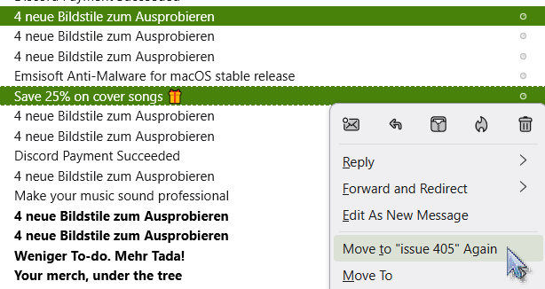
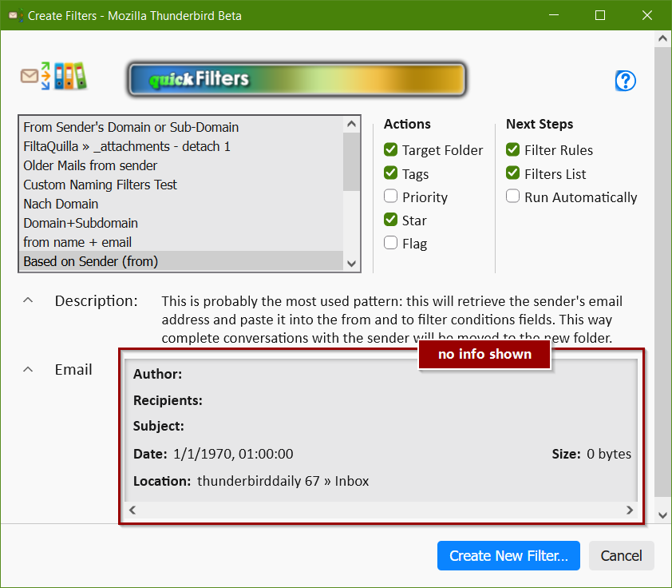
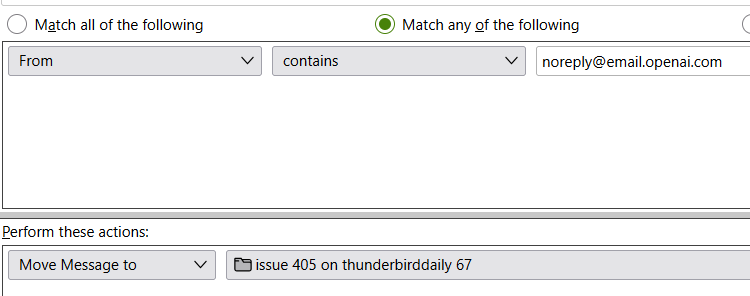
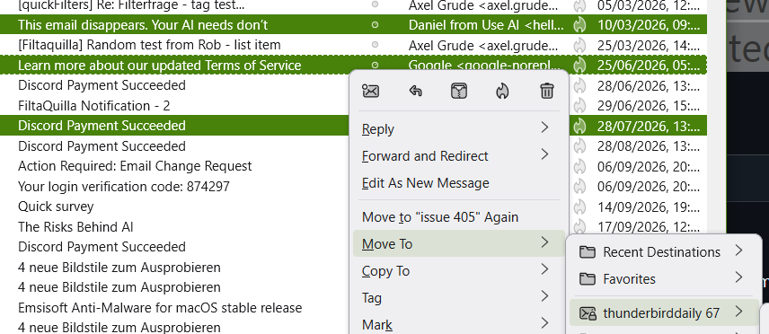
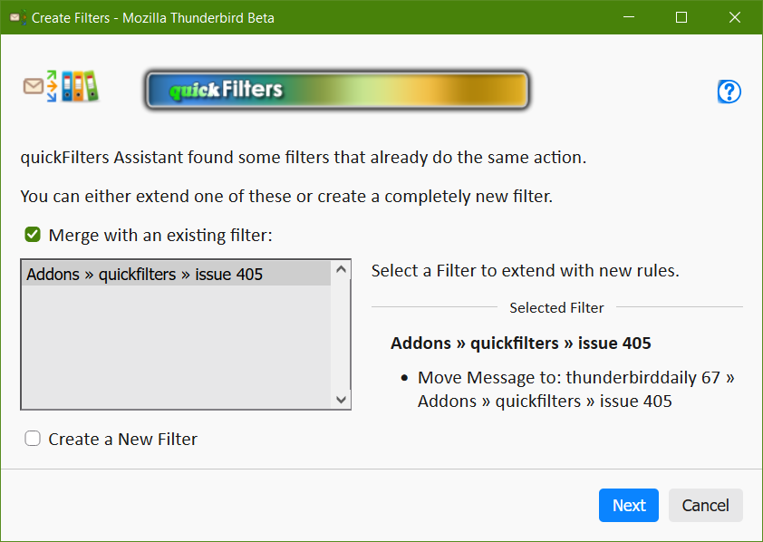
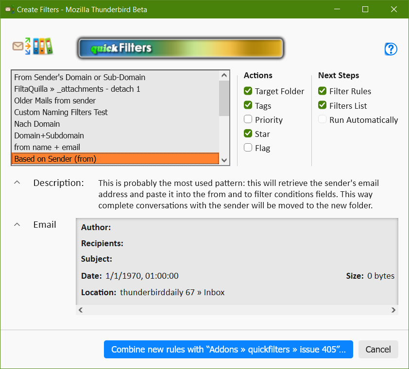
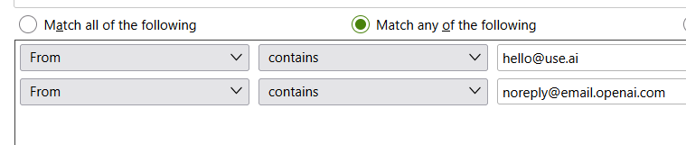

Test Results

Step 1 Create New

- create new, using move to from the Thunderbird context menu

- Assistant is automatically invoked, but the preview area doesn;t show any data (expected result - preview populated from first selected email - to be expanded later 
with a control to step through different previews)

- In the resulting filter, only data from the first email from the thread pane seems to be added (even though the bottom one was selected last)

Step 2 - Merge Filter

try adding more email recipients

- Selecting 3 different mails, middle one last:

- Merge step is displayed, existing filter preselected

- After clicking combine... again no detail is displayed in preview area

- the resulting filter has only a single search term added - again this is the first email from the list

