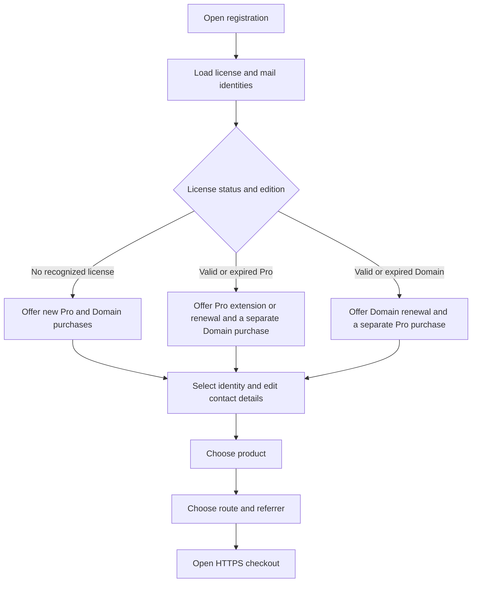

# quickFilters registration: business logic

Working specification for issue #406, adapted from SmartTemplates issue #445. The current registration tab is a live-test scaffold; the original registration dialog and its callers remain available. It is not yet a fully localized production replacement.

## Scope

quickFilters offers Pro for an individual and Domain for a team. There is no Standard edition and no upgrade product. A Domain purchase is separate from a Pro license, including when the user holds a Pro license. The shop displays pricing and collects any seat details; the maintainer describes the Domain product as five Pro seats at five times the Pro price, with additional seats at 50% off. Do not calculate or hard-code prices in the add-on.

The background licenser owns validation and supplies the license status, edition, expiry and existing key. Registration reads that result and editable contact details, presents the corresponding actions and opens the selected product in the external browser. It does not issue or validate keys.

## Checkout routes

Routes below come from the existing quickFilters registration dialog. They must be tested with the live shop without completing payment. The shop base is `https://sites.fastspring.com/quickfolders/`.

| Action | Route | Referrer |
| --- | --- | --- |
| Buy Pro | `instant/quickfilters` | Existing valid or expired key, otherwise originating feature if present |
| Renew or extend Pro | `instant/quickfiltersrenew` | Existing Pro key |
| Buy Domain | `product/quickfiltersdomainlicense` | Existing valid or expired key, otherwise originating feature if present |
| Renew Domain | `product/quickfiltersdomainrenew` | Existing Domain key |

The previous valid or expired key takes precedence for all checkout products, matching the legacy referrer policy. It supports renewal expiry calculations and provides context for a separate purchase, such as a Pro holder buying Domain. With no valid or expired license, use the originating feature if present. Build query parameters with `URLSearchParams` so contact information and the key are encoded once. Never record actual keys or personal details in tests or documentation.

## Test scaffold

The **Current license** scenario reads the actual license and default account identities; its purchase buttons open the live shop. Other scenarios use synthetic license states and do not open checkout. Domain renewal is labeled Renew License whether valid or expired; valid Pro uses Extend License, and expired Pro uses Renew License. Buying the other edition is a separate purchase.

The scaffold currently has English-only dynamic status, action and error text. Verify the live account selection, status refresh, shop routes, contact prefill, valid and expired licenses, invalid keys, keyboard behavior and light/dark themes in Thunderbird. Full localization and production integration remain outstanding. Test shop links without completing payment and redact keys and addresses from shared results.

## Term and seat policy

Do not assume SmartTemplates' Standard-specific upgrade or renewal rules apply. Domain licenses are manually reviewed and issued; confirm the exact quickFilters renewal term and additional-seat ordering path with the maintainer before making specific claims or adding a seat checkout link. The displayed fixture terms are draft copy until checked against quickFilters business rules.

## Recorded live test

- 2026-11-18: With a valid Pro license, the maintainer checked live HTML registration. Extend License opened `instant/quickfiltersrenew` with the existing Pro key as referrer. Buy Domain License opened `product/quickfiltersdomainlicense` without a license referrer under the initial HTML implementation. The policy was subsequently changed to include the existing key for a separate purchase too; retest that referrer. The HTML URL uses standard query encoding. No purchase was made.
