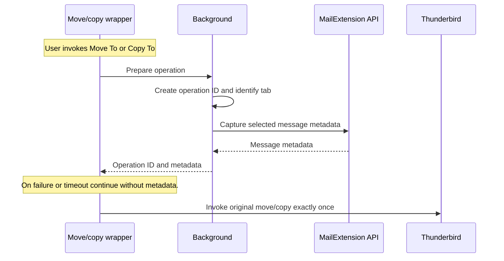
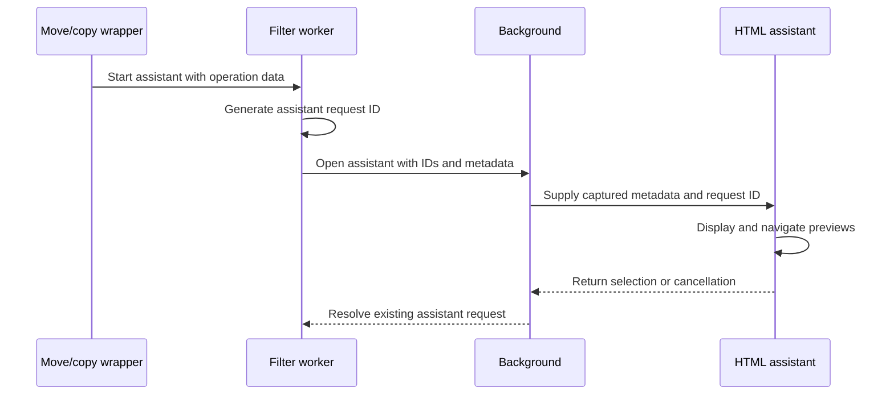

When the assistant is active and messages are moved using Thunderbird's thread-pane context menu, the assistant's email preview can be empty. In testing, quickFilters obtained message IDs associated with the source folder after the move had started. The MailExtension API lookup succeeded but returned empty message details, even though the headers contained the expected information before the move. This appears to be a timing issue involving source message headers becoming stale. The proposed fix captures the preview data before invoking the move:

# Context-menu move: capture preview before moving

When the assistant is active and Thunderbird's Move To or Copy To command is invoked, capture the selected messages' preview metadata through the MailExtension API before calling the original command. The HTML assistant can then display and navigate the captured messages without looking up source-folder message IDs after the move has started.

## 1. Capture and move

The capture exchange is new. The wrapper continues to invoke Thunderbird's original move or copy command.

## 2. Open and complete the assistant

Passing the operation ID and captured metadata to the assistant is new. The assistant request ID and response handshake remain in place.

The originating tab must be identified reliably so that the API captures the intended selection. The operation ID is owned by the background and correlates capture and diagnostics; it is separate from the existing assistant request ID, which continues to identify the assistant's response to the legacy worker. Pass the captured data with the operation instead of relying on a persistent global cache.

The original Thunderbird command must run exactly once whether capture succeeds, fails, or times out. A late capture response must not repeat the move, open an unexpected assistant, or leave operation state behind. If capture is unavailable, continue with the existing assistant behavior. Capturing metadata does not imply that the move has completed, and the assistant should not depend on source-folder API IDs remaining valid after it begins.

## Files

- `chrome/content/quickFilters.js`: request capture from the move/copy wrapper, enforce the bounded wait, invoke Thunderbird's original command, and pass the operation data to the worker.
- `qFi-background.js`: handle capture through the existing NotifyTools listener, create the operation ID, obtain the selected messages with the MailExtension API, and pass captured metadata to the assistant.
- `chrome/content/qFilters-worker.js`: carry the optional operation data through the existing worker and assistant request without breaking other callers, including QuickFolders.
- `html/assistant-dlg.js`: use captured API metadata for preview navigation when present; preserve the existing lookup path for other entry points.

This stage retains the current assistant request and completion handshake. Moving full request ownership to the background is a separate future refactor. Folder-tree drops and direct QuickFolders calls remain separate workflows and require their own testing.
